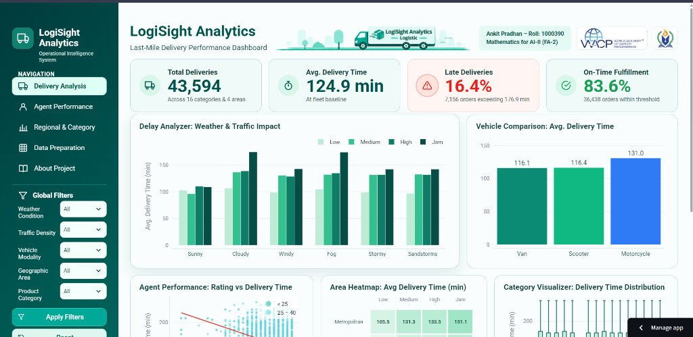
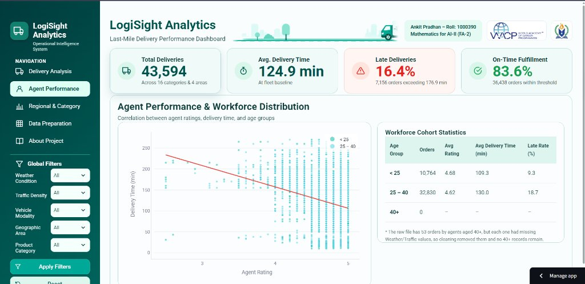
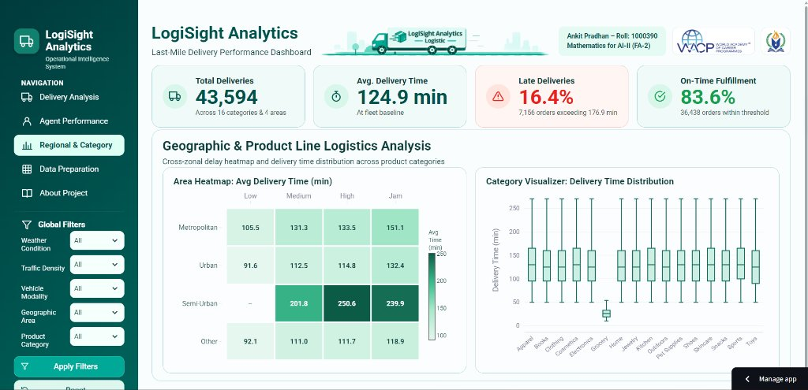
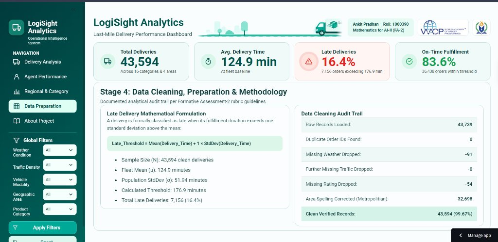
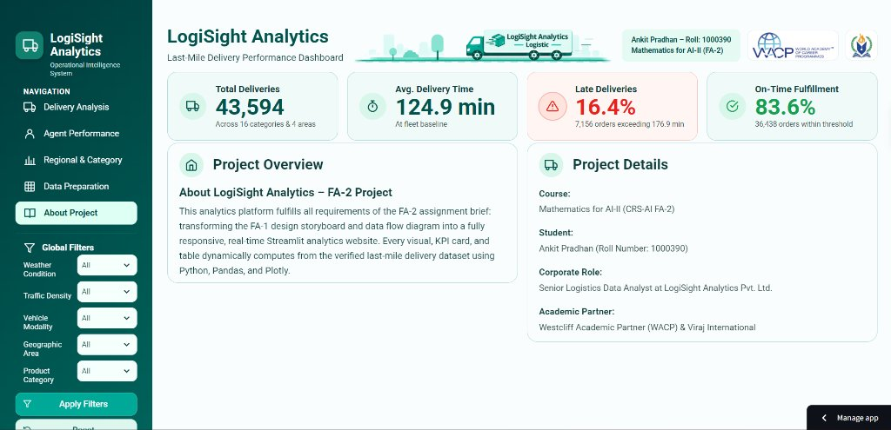
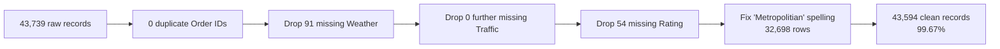

<div align="center">

# 🚚 LogiSight Analytics

### Last-Mile Delivery Performance Dashboard

*From 43,739 raw delivery records to clear, interactive business insight.*


**CRS Artificial Intelligence · Mathematics for AI-II · Formative Assessment-2 (FA-2)**

</div>

---



<div align="center">

### 🔗 Quick Links

[](https://iadai202-1000390-ankitpradhan.streamlit.app/)
[](https://github.com/Ankit4981/IADAI202-1000390-AnkitPradhan)
[](https://drive.google.com/drive/folders/1E4Pv-zKTGaxPPm8e-t-hzRMPL6FJqV6P?usp=drive_link)

</div>

| Resource | Link |
|---|---|
| 🚀 Live dashboard | https://iadai202-1000390-ankitpradhan.streamlit.app/ |
| 💻 GitHub repository | https://github.com/Ankit4981/IADAI202-1000390-AnkitPradhan |
| 📁 Google Drive folder | https://drive.google.com/drive/folders/1E4Pv-zKTGaxPPm8e-t-hzRMPL6FJqV6P?usp=drive_link |

---

## 📑 Table of Contents

1. [About the Project](#-about-the-project)
2. [Key Metrics at a Glance](#-key-metrics-at-a-glance)
3. [Dashboard Tour](#-dashboard-tour)
4. [The Five Compulsory Visualizations](#-the-five-compulsory-visualizations)
5. [Data Preparation & Mathematical Model](#-data-preparation--mathematical-model)
6. [Insights from the Data](#-insights-from-the-data)
7. [Global Filters](#-global-filters)
8. [Getting Started](#-getting-started)
9. [Deploy to Streamlit Cloud](#-deploy-to-streamlit-cloud)
10. [Project Structure](#-project-structure)
11. [Tech Stack](#-tech-stack)
12. [Author & Credits](#-author--credits)

---

## 🎯 About the Project

**LogiSight Analytics** is an interactive business-intelligence dashboard for logistics operations managers. It turns the FA-1 design storyboard into a working web app, built with **Python, Streamlit, Pandas and Plotly**.

A manager can ask questions like:

- *Which weather and traffic mix slows deliveries the most?*
- *Which vehicle type is the fastest?*
- *Do better-rated agents deliver faster?*
- *Which areas and product categories need attention?*

Every number, card, table and chart is **computed live from the dataset**. Nothing is hardcoded, made up, or copied from a reference image.

---

## 📊 Key Metrics at a Glance

| Metric | Value |
|---|---:|
| 📦 Clean deliveries analysed | **43,594** |
| ⏱️ Average delivery time | **124.9 min** |
| ⚠️ Late deliveries | **7,156 (16.4%)** |
| ✅ On-time fulfilment | **36,438 (83.6%)** |
| 🚦 Late threshold | **176.9 min** |
| 🗂️ Product categories / areas | **16 / 4** |

---

## 🖥️ Dashboard Tour

The sidebar has **five sections**. A KPI strip (total, average time, late %, on-time %) stays at the top of every page.

### 1️⃣ Delivery Analysis
Weather × traffic impact, vehicle comparison, an interaction matrix and a fleet performance table.


### 2️⃣ Agent Performance
Agent rating vs. delivery time as a scatter plot with a trendline, plus a workforce cohort table by age group.



### 3️⃣ Regional & Category
A heatmap of average delivery time by area and traffic, and a boxplot of delivery time across all 16 product categories.



### 4️⃣ Data Preparation
The late-delivery formula, the full cleaning audit trail and the methodology, so every step can be checked.



### 5️⃣ About Project
Project overview, course details, student information and academic partners.



---

## 📈 The Five Compulsory Visualizations

| # | Visualization | Chart type | Key fields |
|:-:|---|---|---|
| 1 | **Delay Analyzer** | Grouped bar chart | Weather, Traffic, Delivery_Time |
| 2 | **Vehicle Comparison** | Bar chart | Vehicle, Delivery_Time |
| 3 | **Agent Performance** | Scatter plot + trendline | Agent_Rating, Delivery_Time, Agent_Age_Group |
| 4 | **Area Heatmap** | 2D heatmap | Area, Traffic, Delivery_Time |
| 5 | **Category Visualizer** | Boxplot | Category, Delivery_Time |

---

## 🧮 Data Preparation & Mathematical Model

### What counts as a "late" delivery?

A delivery is **late** when it takes longer than one standard deviation above the fleet average:

```
Late_Threshold = Mean(Delivery_Time) + 1 × StdDev(Delivery_Time)
```

| Quantity | Value |
|---|---:|
| Sample size (N) | 43,594 clean deliveries |
| Fleet mean (μ) | 124.9 min |
| Standard deviation (σ) | 51.94 min |
| **Late threshold** | **176.9 min** |
| Late deliveries | 7,156 (16.4%) |
| On-time deliveries | 36,438 (83.6%) |

The threshold is calculated once on the full clean dataset. It **does not change** when filters are applied, so late rates stay comparable across every view.

### 🧹 Cleaning audit trail



| Step | Rows affected |
|---|---:|
| Raw records loaded | 43,739 |
| Duplicate Order IDs found | 0 |
| Missing Weather dropped | 91 |
| Further missing Traffic dropped | 0 |
| Missing Rating dropped | 54 |
| Area spelling corrected (*Metropolitian → Metropolitan*) | 32,698 |
| **Clean verified records** | **43,594 (99.67%)** |

> ⚠️ **Data note:** the raw file has 53 orders by agents aged 40+. Each had missing Weather/Traffic values, so cleaning removed them and the **40+ cohort is empty** in the dashboard.

---

## 💡 Insights from the Data

These come straight from the charts above.

- 🚦 **Traffic is the biggest driver.** In every weather condition, *Jam* gives the longest average delivery time.
- 🏍️ **Motorcycles are the slowest vehicle** at 131.0 min, compared with 116.1 min for vans and 116.4 min for scooters.
- 🏙️ **Semi-Urban areas struggle most.** Average time reaches **250.6 min** in High traffic and **239.9 min** in Jam, far above Urban (132.4 min in Jam) and Other (118.9 min in Jam).
- 👥 **The 25–40 age cohort has a much higher late rate** (18.7%) than the under-25 cohort (9.3%), with average times of 130.0 vs 109.3 min.
- 📉 **Higher agent ratings go with shorter delivery times.** The scatter plot trendline slopes downward.
- 📦 **Grocery looks different from every other category.** Its boxplot shows a much lower delivery-time range than the rest.

---

## 🎛️ Global Filters

Five multiselect filters sit in the sidebar:

| Filter | Example values |
|---|---|
| 🌦️ Weather Condition | Sunny, Cloudy, Windy, Fog, Stormy, Sandstorms |
| 🚦 Traffic Density | Low, Medium, High, Jam |
| 🛵 Vehicle Modality | Van, Scooter, Motorcycle |
| 📍 Geographic Area | Metropolitan, Urban, Semi-Urban, Other |
| 🛍️ Product Category | 16 categories |

- **Empty selection = All**, so no filtering is applied.
- **Apply Filters** updates every KPI, chart and table.
- **Reset** restores the full dataset.
- Selections **persist across sections** through Streamlit session state.

---

## 🚀 Getting Started

```bash
# 1. Clone the repository
git clone https://github.com/Ankit4981/IADAI202-1000390-AnkitPradhan.git
cd IADAI202-1000390-AnkitPradhan

# 2. Create and activate a virtual environment
python -m venv .venv
# Windows:
.venv\Scripts\activate
# macOS / Linux:
source .venv/bin/activate

# 3. Install dependencies
pip install -r requirements.txt

# 4. Run the app
streamlit run app.py
```

On Windows you can also double-click **`run_app.bat`**.

The dashboard opens at **http://localhost:8501**, or use the [live app](https://iadai202-1000390-ankitpradhan.streamlit.app/) without installing anything.

---

## ☁️ Deploy to Streamlit Cloud

1. Push the repository to GitHub.
2. Open [share.streamlit.io](https://share.streamlit.io) and sign in.
3. Click **New app** and connect the repository.
4. Set `app.py` as the main file.
5. Click **Deploy**.

Make sure `requirements.txt` and the `data/` folder with the CSV are in the repo.

---

## 🗂️ Project Structure

```text
IADAI202-1000390-AnkitPradhan/
├── app.py                                  # Complete Streamlit application
├── requirements.txt                        # Python dependencies
├── run_app.bat                             # One-click launcher (Windows)
├── test_app.py                             # Automated test suite
├── README.md                               # This documentation
├── COURSE-8 (FA-2 Assignment Brief).docx   # Official assignment brief
├── HTML storyboard.html                    # FA-1 design storyboard
├── .gitignore                              # Git exclusions
├── .streamlit/
│   └── config.toml                         # Theme configuration
├── data/
│   └── Last_mile_Delivery_Data.csv         # Source dataset (43,739 records)
└── assets/
    ├── wacp.png, viraj.png                 # Institutional logos
    ├── banner.png, banner_bg.png, truck.png  # Animated header artwork
    └── screenshots/                        # Images used in this README
        ├── 01-delivery-analysis.png
        ├── 02-agent-performance.png
        ├── 03-regional-category.png
        ├── 04-data-preparation.png
        └── 05-about-project.png
```

---

## 🧰 Tech Stack

| Technology | Purpose |
|---|---|
| 🐍 **Python 3.11+** | Core language |
| 🎈 **Streamlit** | Web app framework |
| 🐼 **Pandas** | Loading, cleaning and aggregation |
| 🔢 **NumPy** | Numerical calculations |
| 📊 **Plotly** | Interactive charts |

---

## 👨‍💻 Author & Credits

| | |
|---|---|
| **Developer** | Ankit Pradhan |
| **Roll Number** | 1000390 |
| **Course** | CRS Artificial Intelligence, Mathematics for AI-II (FA-2) |
| **Role (project scenario)** | Senior Logistics Data Analyst, LogiSight Analytics Pvt. Ltd. |
| **Academic partners** | Westcliff Academic Partner (WACP) & Viraj International |

<div align="center">

*Built with Python, Streamlit & Plotly 💚*

</div>
